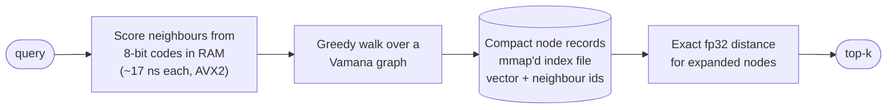

<div align="center">

# Lattice

**A disk-resident vector index in C++, graph-based ANN search that keeps only 8-bit codes in RAM.**

   

[Quick start](#quick-start) · [Performance](#performance) · [How it works](#how-it-works) · [Filtered search](#filtered-search) · [Limitations](#limitations) · [Docs](#documentation)

</div>

---

## At a glance

| | |
|---|---|
| **Recall@10** | 0.975 at **1.3 ms p99** · 0.999 at **4.0 ms p99** (1M vectors, SIFT1M) |
| **Throughput** | **20.6k QPS** (16 threads, recall 0.993) · 6.7k QPS at recall 0.9991 |
| **Index size** | 0.83 GB for 1M × 128-d (only **136 MB** must stay in RAM) |
| **Build** | ~200 s for 1M vectors on 16 threads |
| **Filtered search** | recall@10 ≈ **1.0** at 1% selectivity, p99 < 3 ms |
| **Verified by** | 86 tests · 10,000-point crash-injection · real-data benchmarks vs hnswlib & FAISS |

Measured on a laptop (Ryzen 7, 16 threads, WSL2) with the ANN-Benchmarks protocol. Full methodology, head-to-head tables and caveats: [`docs/BENCHMARKS.md`](docs/BENCHMARKS.md).

## Why Lattice

- **Small RAM footprint, graph-class speed.** Graph traversal is scored from 8-bit (SQ8) codes held in RAM; full-precision vectors and neighbor lists live in a compact, memory-mapped index file. In-RAM hnswlib is about 15–17% faster on one thread; Lattice delivers about **2.5× its throughput at 16 threads**.
- **Persistent and memory-mappable.** The index is a single file. Open it with zero-copy `mmap` (the OS page cache becomes your RAM tier — more RAM, more cached) or via `io_uring`.
- **Filtering that actually keeps recall.** A filter-aware planner scans small match sets directly and widens the graph search for large ones — unfiltered-traversal-plus-post-filter collapses to recall 0.02–0.17 at 0.1–1% selectivity; this holds ≈ 1.0.
- **Built on real-data evidence.** Every claim here was measured on real datasets, not synthetic ones — and the real-data runs found bugs synthetic data hid (see [`docs/BENCHMARKS.md`](docs/BENCHMARKS.md#6-what-changed-along-the-way-why-the-numbers-moved)).

## Python package

```bash
pip install lattice-vdb            # Linux x86_64, Python 3.10+
lattice fetch sift1m
lattice build ~/.lattice/data/sift-128-euclidean.hdf5 sift.lattice
lattice bench sift.lattice ~/.lattice/data/sift-128-euclidean.hdf5 ~/.lattice/data/sift-128-euclidean.hdf5 --ef 32,64,128
```

```python
import lattice_vdb
lattice_vdb.build_index(vectors, "my.lattice", metric="cosine")   # l2, ip or cosine
index = lattice_vdb.Index("my.lattice", preload=True)
ids = index.search(query, k=10, ef_search=64)
```

`lattice --help` lists the commands: `build`, `search`, `info`, `verify`, `bench`, `fetch`.

## Quick start (C++)

```bash
# Debian/Ubuntu prerequisites (system packages)
sudo apt install librocksdb-dev liburing-dev libroaring-dev

git clone <repo-url> && cd lattice
cmake --preset release && cmake --build build/release -j$(nproc)
ctest --test-dir build/release          # 108 tests
./build/release/examples/example_quickstart
```

Requires C++23 (GCC 15+ or Clang 17+) on Linux. On Windows, build under WSL2.

```text
recall@5 vs brute force over 20 queries: 0.95
top-5 even ids for vector 123: 10540 16982 18722 7622 13252
```

### Using the library

The complete, compiled version of this is [`examples/quickstart.cpp`](examples/quickstart.cpp).

```cpp
#include "lattice/quant/sq8.h"
#include "lattice/segment/segment.h"
using namespace lattice; using namespace lattice::index_graph;

// 1. Train the 8-bit codes that stay in RAM, choose a compact node layout, build the graph.
auto book   = quant::Sq8CodeBook::train(ptrs, dim);
quant::Sq8Codes codes(*book);
auto layout = NodeRecordLayout::make_compact(dim, ElemType::kFloat32, /*R=*/64);
VamanaBuildParams params;  params.r = 64;  params.build_list_size = 100;  params.metric = Metric::kL2;
auto built  = VamanaIndex::build(ptrs, dim, codes, params, *layout);   // multi-threaded by default

// 2. Save, then reopen disk-resident (zero-copy mmap; preload=true warms the cache in ~1 s).
built->serialize_to_disk("index.lattice");
auto index = segment::open_disk_resident_vamana("index.lattice", segment::NodeAccess::kMmap, /*preload=*/true);

// 3. Search. ef_search trades recall for speed (32 ≈ 0.975 recall@10, 192 ≈ 0.999 on SIFT1M).
SearchParams sp;  sp.ef_search = 64;
auto top10 = index->search(query, 10, sp);

// 4. Filtered search: pass the exact matching ids (sorted) and an admit callback.
VamanaIndex::FilteredParams fp;  fp.base = sp;  fp.matching_ids = matching_ids;
auto hits = index->search_filtered(query, 10, fp, [&](VectorId id) { return allowed(id); });
```

`Metric::kL2` and `Metric::kInnerProduct` are supported (normalize vectors at ingest for inner product/cosine).

## Performance

Real SIFT1M (1M × 128-d, all 10,000 queries, raw L2, k=10), one query at a time on a single thread unless noted. Warm page cache.

| ef_search | recall@1 | recall@10 | p50 | p99 | QPS (1 thread) | QPS (16 threads) |
|---|---|---|---|---|---|---|
| 32 | 0.981 | 0.975 | 0.32 ms | 1.29 ms | 2,637 | -- |
| 64 | 0.989 | 0.993 | 0.52 ms | 1.95 ms | 1,618 | **20,615** |
| 128 | 0.992 | 0.998 | 0.91 ms | 3.02 ms | 961 | 12,461 |
| 192 | 0.992 | 0.9990 | 1.30 ms | 3.96 ms | 682 | -- |
| 256 | 0.993 | 0.9991 | 1.66 ms | 4.81 ms | 537 | 6,670 |

**Against other systems on the same machine and protocol** (single thread, QPS at matched recall@10):

| ~recall@10 | **Lattice** | hnswlib (in-RAM) | FAISS HNSW-Flat | FAISS IVF-Flat |
|---|---|---|---|---|
| ~0.975 | 2,637 | 3,160 | 2,092 | 877 |
| ~0.999 | 682 | 802 | 698 | — |

At 16 threads Lattice reaches ~2× hnswlib's QPS at matched recall (17.5k vs 8.2k at ~0.99). Published figures (DiskANN, ANN-Benchmarks) come from different hardware and are mostly plots; they are quoted only as context in the benchmark doc.

<details>
<summary><b>Cold start, memory, build time</b></summary>

| | |
|---|---|
| Cold index (evicted from page cache), first 500 queries | 11.5 ms p50 / 19 ms p99 |
| …with `preload=true` (open takes 1.1 s) | 0.41 ms p50 / 0.99 ms p99 |
| Memory when warm | 136 MB pinned + 804 MB evictable page cache (hnswlib level-0 data: 652 MB) |
| Build, 1M × 128-d | ~200 s on 16 threads; ~25–30 min with `build_threads=1` (deterministic) |

WSL's virtual disk and the Windows host add their own caching, so bare-metal NVMe cold numbers will differ.
</details>

## How it works



- **Graph:** Vamana (DiskANN-style) with α-relaxed pruning; the build is parallel (striped per-node locks).
- **Codes:** SQ8 per-dimension scalar quantization gates the traversal; the final ranking uses exact distances. (RaBitQ 1-bit codes are in the library but are *not* used for traversal — they were far less discriminative at 1M real vectors; see [`docs/BENCHMARKS.md`](docs/BENCHMARKS.md#6-what-changed-along-the-way-why-the-numbers-moved).)
- **Storage:** one file of fixed-stride records (832 B at 128-d, R=64), served zero-copy through `mmap`; an `io_uring` backend is also available.
- **Durability:** write-ahead segment lifecycle, RocksDB-backed row store, two-phase durable seal; crash-injection tested over 10,000 points.

## Filtered search

`VamanaIndex::search_filtered` plans per query:

- **Few matches (≤ 150K):** scan only the matching vectors from the in-RAM codes, then rerank exactly. Recall ≈ 1.0 regardless of how the filter correlates with the vectors.
- **Many matches:** graph traversal with the beam widened by 1/selectivity.

| selectivity | filter | unfiltered traversal + post-filter | Lattice planner | p99 |
|---|---|---|---|---|
| 0.1% | uniform | 0.02 | **1.000** | 0.3 ms |
| 1% | uniform | 0.17 | **1.000** | 2.2 ms |
| 1% | spatially clustered | 0.06 | **0.9997** | 2.6 ms |
| 11.5% | spatially clustered | 0.58 | **0.9993** | 19.5 ms |
| 50% | uniform | 0.997 | 0.985–0.994 | 1.7 ms |
| 50% | spatially clustered | 0.93 | 0.88–0.92 | 1.7 ms |

Recall@10, 1M vectors, exact filtered ground truth. Details in [`docs/BENCHMARKS.md`](docs/BENCHMARKS.md).

## Limitations

Being straight about what this is and isn't:

- **A library, not a server.** There is no network API, CLI, or Python package yet.
- **1M-vector scope.** Larger scales (10M/100M) were deliberately dropped to ship a finished 1M system.
- **Strongly clustered filters above ~15% selectivity** use graph traversal and can lose recall (0.88–0.92 at 50%); scanning would restore it at ~45 ms p99.
- **Warm-cache numbers.** "Disk-resident" describes the layout and I/O path, not a cold-NVMe latency guarantee (see cold-start above).
- **Not smaller than hnswlib when fully cached** (~0.94 GB vs 0.65 GB); the benefit is that only 136 MB must stay resident and the rest degrades gracefully under memory pressure.
- **Hard, unstructured data.** On adversarial random 64-d Gaussian data the graph is weaker than hnswlib's (a vector finds itself 83% of the time at `ef_search=64`, vs 97% for hnswlib); on real SIFT1M recall@1 matches hnswlib. `saturate_graph=true` improves connectivity slightly; multi-entry-point or hierarchical search is the likely next step.
- **Hybrid (lexical + vector) and multi-vector retrieval** are planned, not built.
- Linux only (`io_uring`/`mmap`); on Windows use WSL2.

## Project status

<details>
<summary><b>Phase 3 (storage + disk-resident Vamana) — 1M-scale scope complete</b> · exit-gate details</summary>

| Exit gate item | Status |
|---|---|
| 1. Crash-consistency (≥10K injected crash points) | ✅ 10,000/10,000 |
| 2. Recall/latency at disk scale | ✅ met at the 1M scope on real SIFT1M; filtered search measured |
| 3. Disk backend parity (RAM vs disk recall) | ✅ SIFT1M (128-d) and GIST1M (960-d) |
| 4. `R_max` enforcement | ✅ |
| 5. Merge transient-space bound | ✅ |
| 6. `PrimaryKeyIndex::rebuild` after crash | ✅ |
| 7. Grouped top-k never under-fills | ✅ |
| 8. RaBitQ functional correctness + RAM budget | ✅ |

Modules built (8 of the 13 in the full plan): `common`, `kernels`, `quant`, `index_flat`, `index_graph`, `filter`, `storage`, `segment`. Not built (future scope): `index_ivf`, `lexical`, `fusion`, `query`, `api`, `server`, `pybind`.
</details>

## Documentation

| | |
|---|---|
| [`docs/BENCHMARKS.md`](docs/BENCHMARKS.md) | Methodology, head-to-head vs hnswlib/FAISS, cold start, filtered search, how to reproduce |
| [`docs/ARCHITECTURE.md`](docs/ARCHITECTURE.md) | Module map, data/query flow diagrams |
| [`bench/README.md`](bench/README.md) | What each benchmark does; datasets and baselines |
| [`CONTRIBUTING.md`](CONTRIBUTING.md) | Contributor guide |

<details>
<summary><b>Build details & presets</b></summary>

```bash
cmake --preset release && cmake --build build/release -j$(nproc) && ctest --test-dir build/release
```

Other presets: `debug`, `asan`, `tsan`, `bench` (optimized, assertions on), `clang-release`. RocksDB, liburing and CRoaring are system packages located by `find_library`/`find_path` (each linked only by the one module that needs it); GoogleTest is fetched automatically.

Benchmarks read datasets from `bench/data/` (git-ignored). Fetch/export scripts are in `bench/harness/` (`fetch_ann_benchmarks.sh`, `export_sift_binary.py`); set up the Python tooling with `bench/requirements.txt`.

```bash
./build/release/bench/cpp/bench_production_sift1m <sift1m_bin_dir> <index_path> 10000 64 100
./build/release/bench/cpp/bench_filtered_sift1m   <sift1m_bin_dir> <index_path> 300
```
</details>

## License

Lattice is licensed under the [Apache License 2.0](LICENSE): you may use, modify and redistribute it, including commercially, provided you keep the license and [`NOTICE`](NOTICE) and state your changes. It includes an express patent grant and does not grant any right to use the project name or trademarks.

System dependencies (RocksDB, liburing, CRoaring) and the fetched GoogleTest keep their own licenses. Contributions are accepted under the same Apache-2.0 terms (section 5 of the license).
