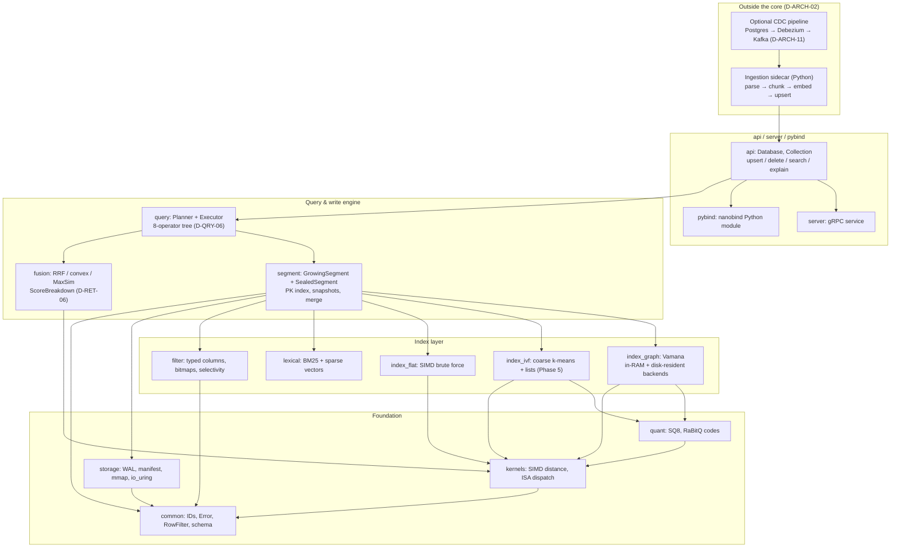
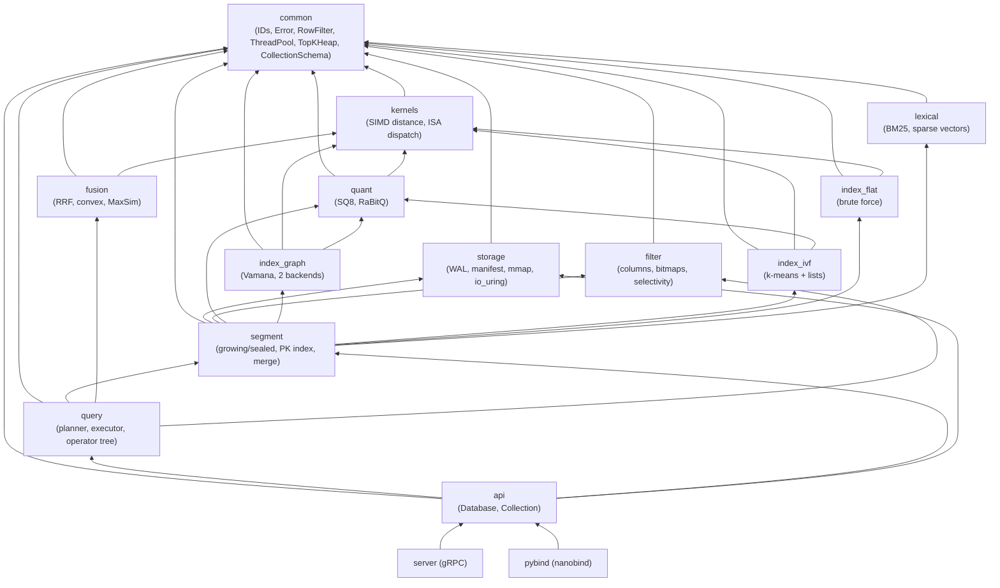
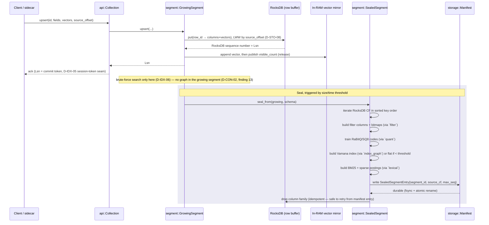
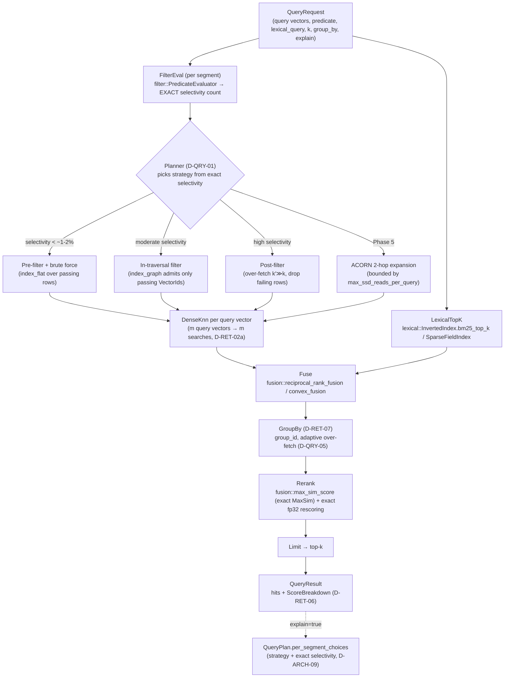
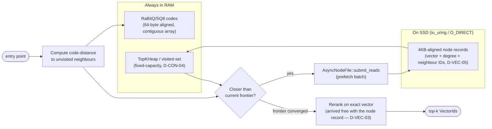
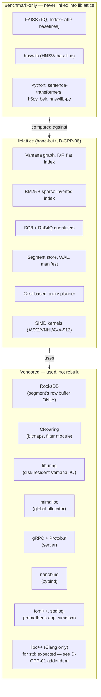
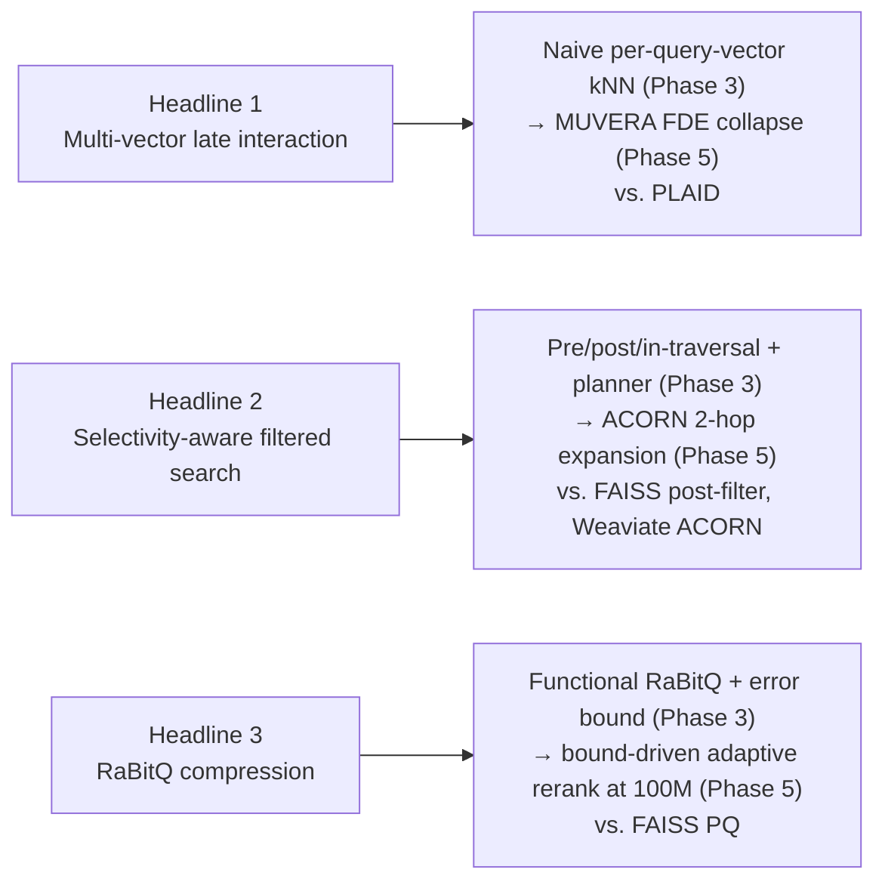
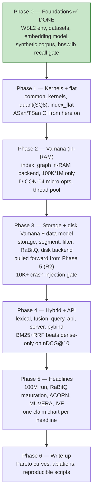
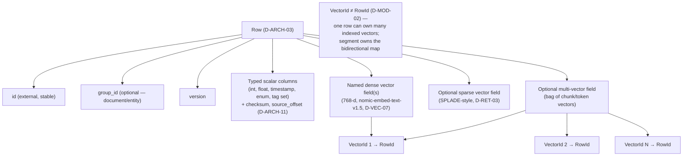

# Lattice — Project Architecture & Flowcharts

A full visual map of the system: what each module does, what it depends on, how a write flows in, how a query flows out, and how the phased build plan gets there. This document describes the full intended design; the scope note below says which parts are built.

> **Scope note (current).** The diagrams below show the full phased plan. The shipped project covers the 1M-vector scope: `common`, `kernels`, `quant`, `index_flat`, `index_graph`, `filter`, `storage`, `segment`. The 10M/100M scale targets and the Phase 4/5 modules (`index_ivf`, `lexical`, `fusion`, `query`, `api`, `server`, `pybind`) are out of scope for this release. **SQ8 (8-bit) is the default codes format for graph traversal**; RaBitQ remains in `quant` as a tested primitive but is not used in traversal, because on real data at 1M vectors its 1-bit estimator was far less discriminative (see `docs/BENCHMARKS.md`). Measured results: see the root `README.md` and `docs/BENCHMARKS.md`.

---

## 1. System overview



**Reading it:** everything outside the dashed boundary of `api` is a separate process (Python sidecar, CDC pipeline) — the C++ core never embeds a model or parses documents (D-ARCH-02). Inside the core, `query` and the write path both terminate at `segment`, which is the only module allowed to touch every index and storage primitive at once.

---

## 2. Module dependency graph (one-way only)



**The one rule that matters (D-MOD-01):** `index_graph` / `index_ivf` / `index_flat` never depend on `filter` or `storage` directly. They receive an opaque `common::RowFilter` (a `bool(RowId)` predicate or bitmap view) and, for the disk backend, an abstract `NodeStore` interface that `segment` implements on top of `storage`'s io_uring file. This is what keeps the index code testable with synthetic predicates and swappable storage backends without ever touching the schema or the filesystem.

External libraries plug in at exactly two points: **RocksDB** inside `segment` only (row-durability buffer, D-ARCH-04), and **FAISS / hnswlib** inside `bench/` only (comparison baselines, never linked into `liblattice`).

---

## 3. Write path — upsert to durable, queryable row



**Why this shape:** RocksDB is the row-durability layer (D-ARCH-04/R3) — it survives a crash on its own, so Lattice's own WAL only has to log segment-lifecycle events (seal/merge/manifest-swap), not every row write. The two-phase handoff (manifest write *before* CF drop) is what makes a crash mid-seal safe to retry (finding 11).

---

## 4. Query path — search to explained result



**The headline claim this diagram exists to support (D-QRY-01):** every branch out of the planner diamond is chosen from an *exact* roaring-bitmap cardinality, never an estimate — that's what `explain=true` surfaces in `per_segment_choices`.

---

## 5. Segment lifecycle (storage engine)

```mermaid
stateDiagram-v2
    [*] --> Growing: first write (RocksDB CF opened)
    Growing --> Sealing: size/time threshold (D-IDX-06 tunable)
    Sealing --> Sealed: manifest write durable, THEN RocksDB CF dropped
    Sealed --> Merging: tombstone ratio > 20% (D-IDX-03) or small-segment policy
    Merging --> Sealed: new merged segment published (rebuild, Phase 3; graph-merge, Advanced)
    Sealed --> Dropped: merged away AND no Snapshot pins it (refcounted, D-STO-05)
    Dropped --> [*]

    note right of Growing
        Brute-force search only (index_flat)
        over an in-RAM vector mirror.
        No graph exists yet.
    end note

    note right of Sealed
        Read-only. mmap + madvise.
        Vamana/IVF/flat index built.
        Lock-free reads (D-CON-02).
    end note
```

---

## 6. Disk-resident Vamana query (the DiskANN-style beam search)



One SSD read per visited node (not two) is the entire point of the co-located node-record layout (D-VEC-05) — the exact vector needed for reranking arrives in the same read as the adjacency list.

---

## 7. Technology stack — what's used where



---

## 8. The three headline differentiators (D-ADV-01)



Each one needs exactly one reproducible claim chart (D-ADV-02).

---

## 9. Phased build plan



Each arrow is a hard gate: a phase exit-gate acceptance tests must pass before the next phase deliverables start.

---

## 10. Data model shape (what a "row" actually is)



---

